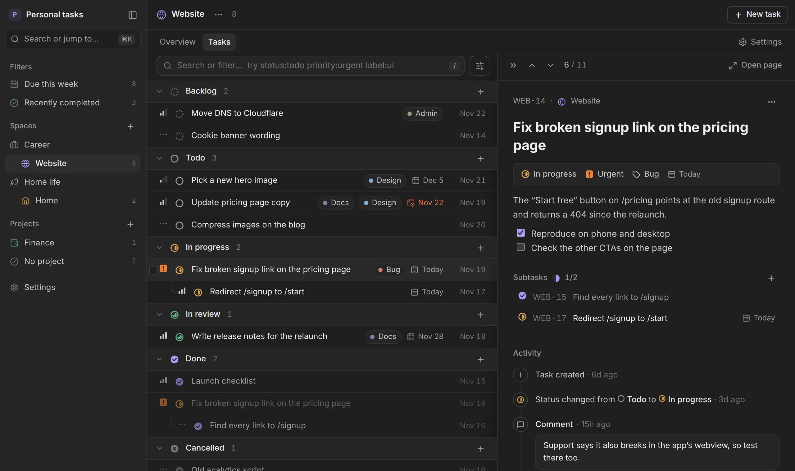
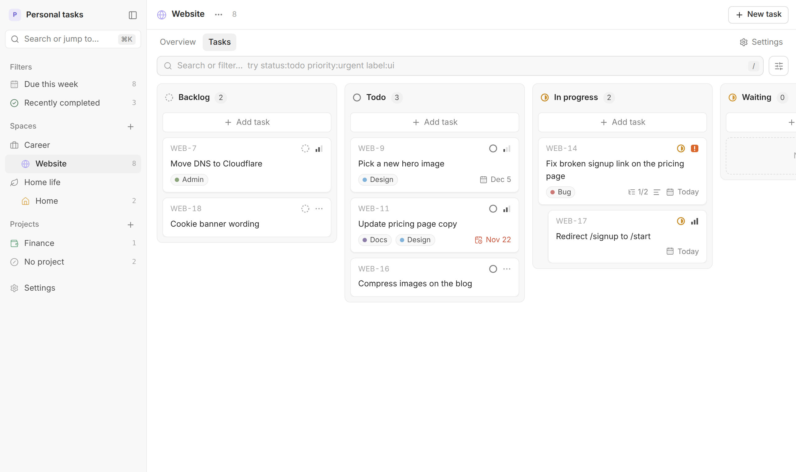
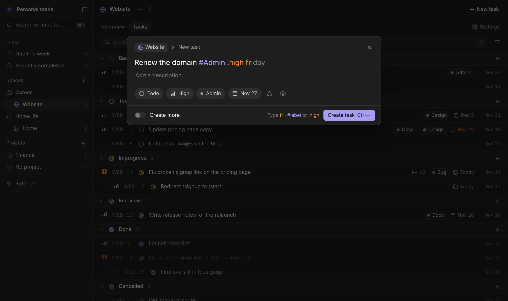
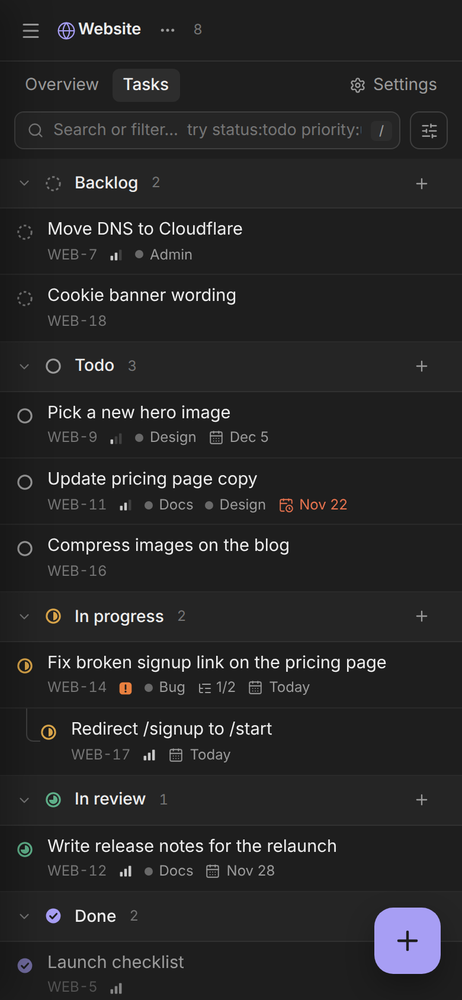

# Tasks for Standard Notes

A task manager that lives in one Standard Notes note: projects with keys (WEB-12), statuses in six
categories, priorities, labels, subtasks, comments and history; a list, a board and a table; quick add
(`Renew the domain #admin !high fri`); a filter language (`status:todo priority:urgent,high due:<7d`);
spaces and cycles; keyboard-first triage; and a phone layout. The design follows the task manager in
[Octarine](https://octarine.app).

The note stays readable Markdown, so your tasks still make sense in any other editor, in a backup, or
years from now. The editor makes no network requests.



## Install

In the Standard Notes phone or desktop app: **Preferences › Plugins › Install Custom Plugin**, then paste

```
https://beshoysabri.github.io/sn-tasks/ext.json
```

Install it from the phone or desktop app; it then syncs to the web app. The web app can't install it
itself: it fetches plugin manifests with credentials, and GitHub's servers answer with a wildcard
`Access-Control-Allow-Origin`, which browsers refuse for such requests.

Then choose **Tasks** as a note's editor. An empty note offers to start a task list; a note that already
has text keeps it at the top.

## What's in it

- **Projects and spaces.** A project has a key, so its tasks are WEB-1, WEB-2 and so on. A task that
  moves to another project gets a new ID, and its old one still finds it. Spaces group projects (Work,
  Home) and have an overview of their own. Tasks can also live outside any project. Drag projects in the
  sidebar to reorder them (on a phone: Move up or Move down in the project's menu).
- **Statuses** in six categories (backlog, unstarted, started, review, completed, cancelled): Backlog,
  Todo, In progress, In review, Done and Cancelled, plus your own. **Priorities** from urgent to low,
  **labels**, **types** (Bug, Feature… each can add labels and a priority), **buckets** (Now, Next, Later)
  and **custom fields** (text, number, date, select, checkbox, link and more).
- **Three views.** The list groups by status, priority, label, type, bucket or project, folds a group's
  closed tasks behind "N closed" and shows subtasks under their parent. The board has a column per status or bucket; drag a card to
  change it. The table shows custom fields as columns and edits them in place. Each place remembers its
  own display options.
- **A task** opens beside the list (Space) or as a page (Enter): its description in Markdown with
  checklists, properties, subtasks, comments, and the history of every change.
- **Quick add** (C) reads `#label`, `!priority` and dates (`fri`, `tomorrow`, `Dec 12`) as you type.
  Tab completes a word; Backspace right after a date or priority keeps it as plain text.
- **Filters** (/): `status:todo priority:urgent,high label:docs due:<7d -label:bug is:overdue "exact words"`.
  Terms must all match, commas mean "or", a minus excludes. Keys: status, priority, label, type, bucket,
  cycle, space, project, is, has, due, created, completed, and custom fields by name. `due:this-week` and
  `due:next-week` follow your week. Save any search as a filter in the sidebar.
- **Cycles**: repeating time boxes of one to four weeks, starting on the weekday you choose. Put tasks in
  the current or the upcoming cycle (Y). When a cycle ends, completing it asks where unfinished work goes
  and keeps its numbers.
- **Project overview**: progress, an activity chart (by status or by label, over 7, 30 or 90 days or a year),
  what's up next, and links. Archived projects and spaces stay one click away in the sidebar.
- **Two devices, one note.** Changes from another device are merged task by task. If a task you're
  editing changed elsewhere, you choose: keep mine or discard mine. If Standard Notes still makes a
  conflicted copy, Settings › General › Conflicted copies brings the copy's work back: tasks and comments
  only the copy has return, the later edit wins, and you pick between two titles or descriptions.
- **Your week**: Settings › General sets the day weeks start on (Saturday, Sunday or Monday). It decides
  "This week" for due dates and the Due this week filter, "Next week" when picking a date or typing
  `next week`, and the weekly bars of the activity chart.
- **Export** (Settings › General) as CSV for a spreadsheet, Markdown, or JSON with everything, in the
  desktop and web apps.
- **On a phone**: one column, the sidebar as a drawer, a + button, and a long-press on a task for its menu.
- **Undo** (⌘Z or Ctrl+Z) for every change, and **themes**: it follows your Standard Notes theme, light or
  dark. If drawing ever fails, you see the note's text instead of a blank editor.







## Keys

| Keys | Does |
| --- | --- |
| J / K, ↓ / ↑ | Move down / up (with Shift: extend the selection) |
| X, ⌘A | Select, select all |
| Space, Enter | Preview the task, open it as a page |
| S P L D | Change status, priority, labels, due date |
| M T B Y | Move to a project, set the type, bucket, cycle |
| C | New task (in an open task: comment) |
| E | Edit the open task's title |
| / | Search and filter |
| ⌘K | Search or jump to anything |
| ⌘Z, ⇧⌘Z | Undo, redo |
| Esc | Close, clear the selection |
| ? | Every key |

On Windows and Linux, Ctrl stands in for ⌘. The change keys work on the selection, or on the focused
task when nothing is selected.

## The note

A Tasks note is Markdown with a short settings block at the top: `#` is a space, `##` a project, `###` a
task and `####` a subtask, with properties one per line and history at the end of each task.

```markdown
---
tasks: 1
no-project: {"key":"TASK","next":4}
labels:
  - {"name":"Bug","color":"#CB7876"}
---

# Career
- Ref: career

## Website
- Key: WEB
- Next: 19
- Status: In progress
- Ref: website

### WEB-14 Fix broken signup link on the pricing page
- Status: In progress
- Priority: Urgent
- Labels: Bug
- Due: 2026-11-25
- Created: 2026-11-19T09:00Z
- Ref: demo01

The “Start free” button on /pricing points at the old signup route.

- [x] Reproduce on phone and desktop
- [ ] Check the other CTAs on the page

> 2026-11-19T09:00Z · Created
> 2026-11-22T09:00Z · Status: Todo → In progress
> 2026-11-24T07:00Z · Comment: Support says it also breaks in the app’s webview.

#### WEB-15 Find every link to /signup
- Status: Done
- Created: 2026-11-16T09:00Z
- Completed: 2026-11-24T08:00Z
- Ref: demo02
```

You can edit it by hand in any editor: a task heading without an ID gets the next one, and lines Tasks
doesn't know stay in the description.

## Coming from Kanban Board

Switch a [Kanban Board](https://github.com/beshoysabri/sn-kanban-board) note's editor to Tasks. Its board
becomes a project, with columns as statuses and cards as tasks, and the note is saved in the Tasks format
on your first change. Until then it stays exactly as it was, so you can switch back.

## Coming from Octarine

A one-time import turns the tasks in an Octarine workspace into a Standard Notes backup holding a single
Tasks note:

```
npx vite-node scripts/import-octarine.ts <path to the workspace's .octarine folder> "Tasks" > tasks.json
```

Import `tasks.json` under **Preferences › Backups › Import backup**. Projects keep their keys and task
numbers, IDs from earlier keys keep finding their tasks, and statuses, labels, types, buckets, saved
filters and history come along; archived labels come only if a task still uses them. Octarine has no week
setting, so if your cycles start on a Saturday, Sunday or Monday, your weeks start there too. The script
lists anything it couldn't read. Keep its output out of this repository: it holds your real tasks.

## Development

```
npm install
npm run dev      # the editor with a made-up demo workspace at http://localhost:5173
npm test         # Vitest, through a fake Standard Notes host
npm run lint
npm run build    # then: node scripts/check-bundle.mjs dist (first load must stay under 150 KB gzipped)
```

To try a local build inside Standard Notes, install `public/ext.dev.json` while `npm run dev` runs.
`node scripts/sn-check.mjs dist <folder>` installs a build in the real Standard Notes web app (no account;
needs Chromium), makes a task with quick add, and saves screenshots and the note's text in that folder.
CI runs lint, tests, the build and the size check on every
branch. Pushing `main` deploys to GitHub Pages. [docs/design.md](docs/design.md) records how the code is
laid out and the decisions behind it.

Every task in this repository (the demo workspace, the tests, the screenshots) is made up.

## License

MIT
